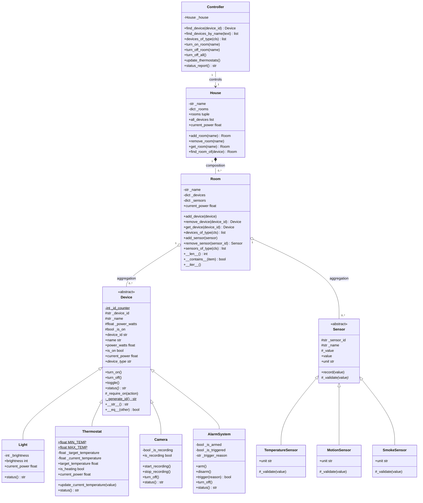
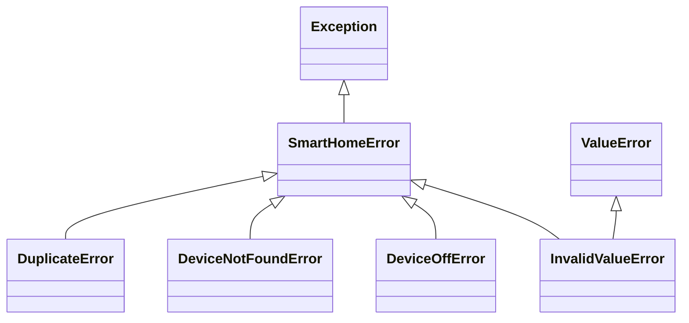

# Report 01 – Smart Home Automation System (Stage 1)

**Student:** Furkan Ergül
**Course:** Object Based Programming (2019G0005) – Dr. Coşkun Şahin
**Assignment:** #8 Smart Home Automation System – Stage 1: Architecture

This report explains which OOP principles are applied in the classes created
during Stage 1 and in the definitions inside them. A UML class diagram of the
structure is given in section 2.

---

## 1. Design approach

Following the advice in the assignment sheet (*"imagine and understand the
behaviour, then find the object"*), the design started from what a smart home
must **do**:

| Real behaviour | Responsible object |
|---|---|
| A device can be switched on/off and consumes power | `Device` |
| A light can be dimmed, a thermostat heats, a camera records, an alarm is armed/triggered | `Light`, `Thermostat`, `Camera`, `AlarmSystem` |
| Something measures the environment (temperature, motion, smoke) | `Sensor` and its subclasses |
| Devices and sensors are physically placed somewhere | `Room` |
| A home is made of rooms | `House` |
| Somebody must control everything from one place | `Controller` |

Each class has **one responsibility** (high cohesion) and knows as little as
possible about the others (low coupling). Abstract base classes (`Device`,
`Sensor`) are used only where variation is expected: new device types and new
sensor types will certainly be added in the next stages.

---

## 2. UML class diagram

**Notation:** `+` public, `#` protected (`_name` in Python), `-` private/internal,
`*` abstract, `$` static / class level.

### Exceptions

### Relationships

| Relationship | Type | Why |
|---|---|---|
| `Light`, `Thermostat`, `Camera`, `AlarmSystem` → `Device` | **Inheritance** ("is-a") | Every one of them *is a* device: on/off state, id, name, power. |
| `TemperatureSensor`, `MotionSensor`, `SmokeSensor` → `Sensor` | **Inheritance** | Every one *is a* sensor with a value and a unit. |
| `House` ◆— `Room` | **Composition** | The house creates its rooms in `add_room()`. A room has no meaning without its house; removing the room from the house destroys it. |
| `Room` ◇— `Device` / `Sensor` | **Aggregation** | Devices are created outside and placed in a room. `remove_device()` returns the device, so it continues to exist and can be moved to another room. |
| `Controller` → `House` | **Association / dependency injection** | The controller does not create the house; it receives it in its constructor and only uses it. |

---

## 3. OOP principles per class

### 3.1 `Device` (abstract base class) – `smart_home/devices.py`

| Principle | Where in the code |
|---|---|
| **Abstraction** | `Device` inherits from `ABC`. `device_type` and `status()` are marked `@abstractmethod`, so `Device("x", 10)` raises `TypeError`: only concrete devices can be created. The class describes *what* a device is, not *how* each type works. |
| **Encapsulation** | All state is stored in protected attributes (`_device_id`, `_name`, `_power_watts`, `_is_on`). They are exposed through **read-only `@property`s**, so `lamp.is_on = True` raises `AttributeError`; the state can only change through `turn_on()` / `turn_off()` / `toggle()`. The constructor validates the name and power (`InvalidValueError`). |
| **Class attribute & class method** | `_id_counter` is shared by all devices; the `@classmethod _generate_id()` uses it to give every device a unique id (`DEV-001`, `DEV-002`, …). |
| **Template / reuse** | `toggle()` and `__str__()` are written once in the base class but call `turn_on()`, `turn_off()`, `device_type`, `status()` – which subclasses can override. `_require_on()` is a protected helper reused by `Camera` and `AlarmSystem`. |
| **Magic (dunder) methods** | `__str__` (user friendly text), `__repr__` (developer text), `__eq__` and `__hash__` (two objects are equal if they have the same id, so devices can be used in sets/dicts). |

### 3.2 `Light`, `Thermostat`, `Camera`, `AlarmSystem` (subclasses)

| Principle | Where in the code |
|---|---|
| **Inheritance** | All four classes extend `Device` and call `super().__init__(name, power_watts)`, reusing id generation, validation and on/off logic. |
| **Method overriding** | Each class implements `device_type` and `status()` in its own way. `Light.current_power` scales with brightness, `Thermostat.current_power` is non-zero only while heating. `Camera.turn_off()` also stops recording and `AlarmSystem.turn_off()` also disarms – both then call `super().turn_off()` (extending, not replacing, the parent behaviour). |
| **Encapsulation with validation (setters)** | `Light.brightness` and `Thermostat.target_temperature` are properties with **setters** that reject invalid values (`0–100 %`, `5–35 °C`). Even the constructor uses the setter, so an invalid object can never be created. |
| **Computed properties** | `Thermostat.is_heating` is calculated from the state (ON + current temperature < target) instead of being stored, so it can never become inconsistent. |
| **Class constants** | `Thermostat.MIN_TEMP` / `MAX_TEMP` are class-level constants shared by all thermostats. |
| **Custom exceptions** | `Camera.start_recording()` and `AlarmSystem.arm()` raise `DeviceOffError` when the device is OFF. |

### 3.3 `Sensor` and its subclasses – `smart_home/sensors.py`

| Principle | Where in the code |
|---|---|
| **Abstraction** | `Sensor` is abstract (`unit` and `_validate()` are abstract). |
| **Encapsulation** | The reading is stored in `_value` and can only be changed through `record()`, which first calls `_validate()`. An invalid reading (e.g. `500 °C` or `"hot"`) raises `InvalidValueError` and the previous value is kept. |
| **Polymorphism** | `record()` is written once in `Sensor`, but `self._validate(value)` executes the version of the real subclass: a `TemperatureSensor` checks a number in `-50…100`, a `MotionSensor` accepts only `True/False`, a `SmokeSensor` checks `0…100 %`. |
| **Separation of responsibilities** | A sensor only *measures*; it never switches a device on. Acting on readings is the job of the `Controller` (and of the automation rules in Stage 2). |

### 3.4 `Room` – `smart_home/room.py`

| Principle | Where in the code |
|---|---|
| **Aggregation** | Keeps references to existing `Device` and `Sensor` objects. |
| **Encapsulation / information hiding** | The dictionaries `_devices` and `_sensors` are never returned directly. `devices` and `sensors` return a **tuple copy**, so outside code cannot add or remove items without going through `add_device()` / `remove_device()`, which validate the input and raise `DuplicateError` / `DeviceNotFoundError`. |
| **Polymorphism** | `current_power` sums `device.current_power` for every device without knowing its type – each subclass returns its own value. `devices_of_type(Light)` uses `isinstance` to filter by class. |
| **Magic methods** | `__len__` (`len(room)`), `__contains__` (`lamp in room`), `__iter__` (`for device in room`). This makes a `Room` behave like a built-in Python collection. |

### 3.5 `House` – `smart_home/house.py`

| Principle | Where in the code |
|---|---|
| **Composition** | `add_room(name)` creates the `Room` object itself; rooms are owned by the house. |
| **Encapsulation** | `_rooms` is private; room names are looked up case-insensitively through `get_room()`. |
| **Delegation** | `current_power` and `all_devices` ask each room instead of doing the work itself – each class does its own job. |

### 3.6 `Controller` – `smart_home/controller.py`

| Principle | Where in the code |
|---|---|
| **Dependency injection / low coupling** | The house is passed in the constructor (`Controller(house)`). The controller can therefore work with any house, and it is easy to test with a small test house. |
| **Programming to an abstraction** | The controller works with `Device` and `Sensor` (the abstract types). `turn_on_room()` calls `device.turn_on()` for every device, and `status_report()` calls `str(device)` – a new device type added in Stage 2/3 will work without changing the controller. |
| **Polymorphism** | `status_report()` prints every device with the same call, but each device shows its own `status()` (brightness, temperature, recording, armed…). |
| **Collaboration of objects** | `update_thermostats()` reads the `TemperatureSensor`s of each room and passes the average to the `Thermostat`s of the same room. |

### 3.7 Exceptions – `smart_home/exceptions.py`

A small **exception hierarchy** (inheritance again): every error inherits from
`SmartHomeError`, so a caller can catch all errors of the package with one
`except SmartHomeError`. `InvalidValueError` also inherits from `ValueError`
(**multiple inheritance**), so it can be caught as a normal Python value error too.

---

## 4. Summary: principle → classes

| OOP principle | Applied in |
|---|---|
| Classes & objects, constructors (`__init__`) | all classes |
| Encapsulation (protected attributes, properties, validating setters) | `Device`, `Light`, `Thermostat`, `Camera`, `AlarmSystem`, `Sensor`, `Room`, `House` |
| Abstraction (ABC, `@abstractmethod`) | `Device`, `Sensor` |
| Inheritance & `super()` | 4 device classes, 3 sensor classes, exception hierarchy |
| Polymorphism & method overriding | `status()`, `device_type`, `current_power`, `turn_off()`, `_validate()`, `unit` |
| Composition | `House` → `Room` |
| Aggregation | `Room` → `Device`, `Room` → `Sensor` |
| Association / dependency injection | `Controller` → `House` |
| Class attributes, class methods, class constants | `Device._id_counter`, `Device._generate_id()`, `Thermostat.MIN_TEMP` |
| Magic methods | `__str__`, `__repr__`, `__eq__`, `__hash__`, `__len__`, `__contains__`, `__iter__` |
| Custom exceptions | `exceptions.py` |
| Unit testing | `tests/` – 33 tests with `unittest` |

---

## 5. How the design prepares the next stages

- **Stage 2 – automation & energy:** `Thermostat.is_heating` and
  `Controller.update_thermostats()` already implement the *"temperature < threshold
  → heater on"* idea; every device already reports `current_power`, so an energy log
  per room and sorting devices by power/activity can be added without changing
  existing classes.
- **Stage 3 – events:** sensors already store readings through one method
  (`record()`), which is the natural place to fire a `SensorTriggeredEvent`.
  `AlarmSystem.trigger(reason)` and `Camera.start_recording()` are ready to be
  used by a fire / break-in scenario.
- New device or sensor types only need a new subclass – `Room`, `House` and
  `Controller` do not change (*open for extension, closed for modification*).

---

## AI Usage Statement

Claude (Anthropic, model Claude Opus 5.5, via Claude Code) was used in the
**source code, unit tests and documentation (Readme.md, Report_01.md)** sections of
this product. The tool was utilized via the prompt/input *"Build Stage 1 of the
Smart Home Automation System assignment in Python using OOP principles, with tests,
Readme and a report with a UML diagram"* for the purpose of **code generation and
documentation**. The output generated has been reviewed and verified by me for
technical accuracy, safety, and originality. I bear full responsibility for the work.
